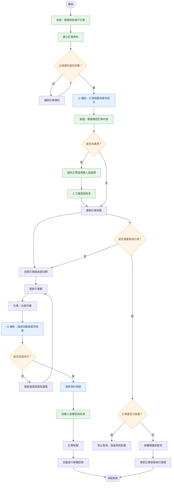

# 訂單管理系統 POC 流程圖

## 一、系統流程圖（Mermaid）

## 二、流程中的 AI 應用

| 流程階段 | AI 功能 | 人員責任 |
|---|---|---|
| 訂單建立 | 輔助整理訂單摘要、辨識缺漏欄位 | 客服／業務確認資料 |
| 訂單檢查 | 提示資料矛盾、交期或數量異常 | 業務確認並處理 |
| 進度管理 | 輔助識別進度落後及異常 | 工廠與相關人員處理 |
| 請款作業 | 預檢請款資料是否完整 | 財務確認與核准 |
| 通知與紀錄 | 輔助產生通知、摘要及操作紀錄 | 主管與權責人員決策 |

## 三、取消訂單與結案規則

1. **未結案訂單：** 依權限確認後，才可執行取消。
2. **已結案訂單：** 不顯示取消訂單選項，禁止取消。
3. **取消成功：** 更新訂單狀態及行事曆。
4. **完成結案：** 訂單自動從行事曆排除。
5. **AI 權限限制：** AI 僅提供建議、摘要與異常提示，不得自行核准或執行未授權操作。

## 四、RACI 角色分工

| 工作項目 | 客服／業務 | 工廠／出貨 | 財務 | 主管 | IT／開發 | AI |
|---|---|---|---|---|---|---|
| 建立訂單 | R/A | I | I | I | C | C |
| 訂單資料檢查 | R/A | C | I | I | C | R（輔助） |
| 生產與出貨 | C | R/A | I | I | I | C |
| 異常處理 | R | R | C | A | C | C |
| 請款與結案 | C | C | R/A | I | I | C |
| 特殊取消核准 | R | C | I | A | C | C |
| 系統維護 | I | I | I | A | R | — |

**RACI 說明：**
- R（Responsible）：執行工作
- A（Accountable）：最終負責／核准
- C（Consulted）：提供意見
- I（Informed）：接收通知

> 註：AI 在表格中標示為輔助角色，不代表具有正式簽核權限。實際 RACI 應依公司授權制度調整。
